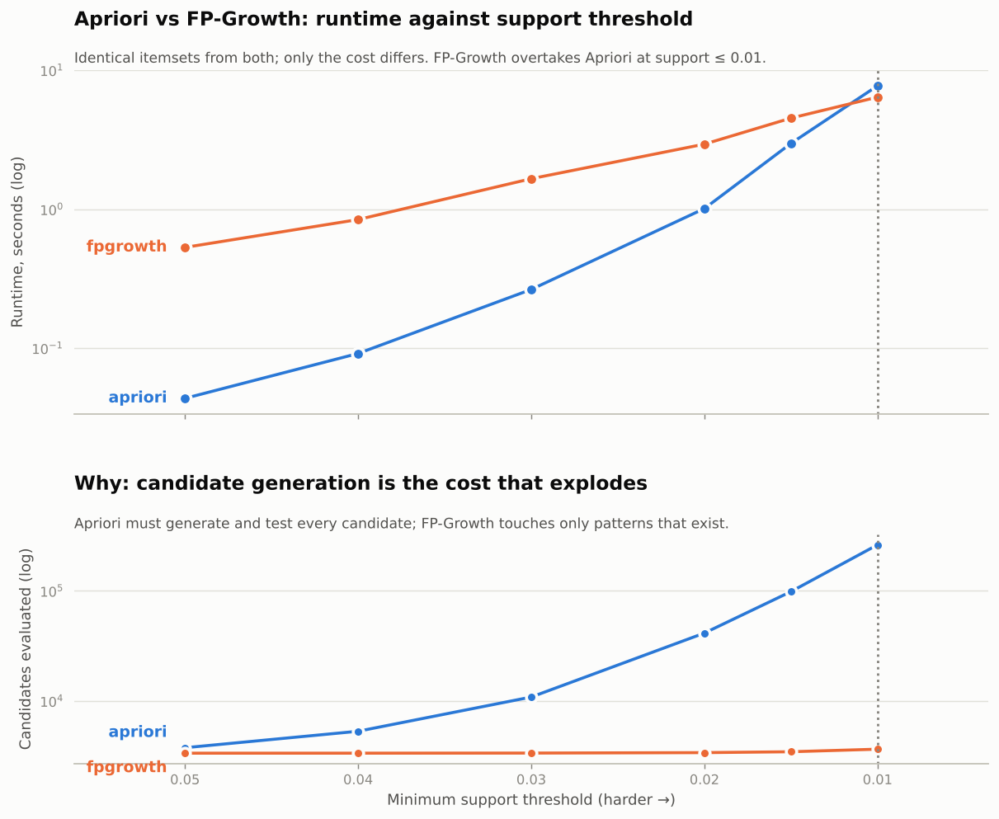
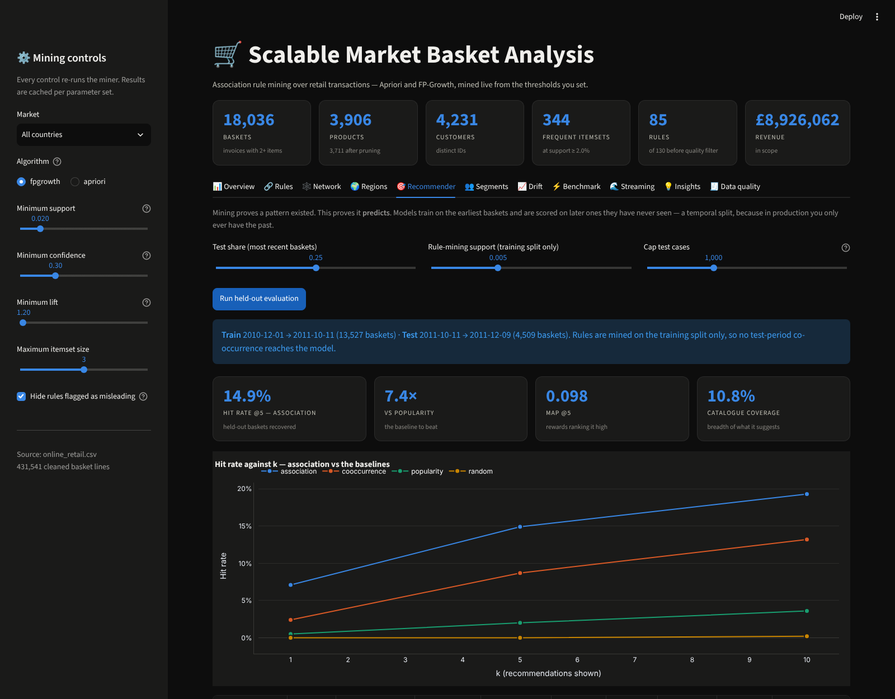
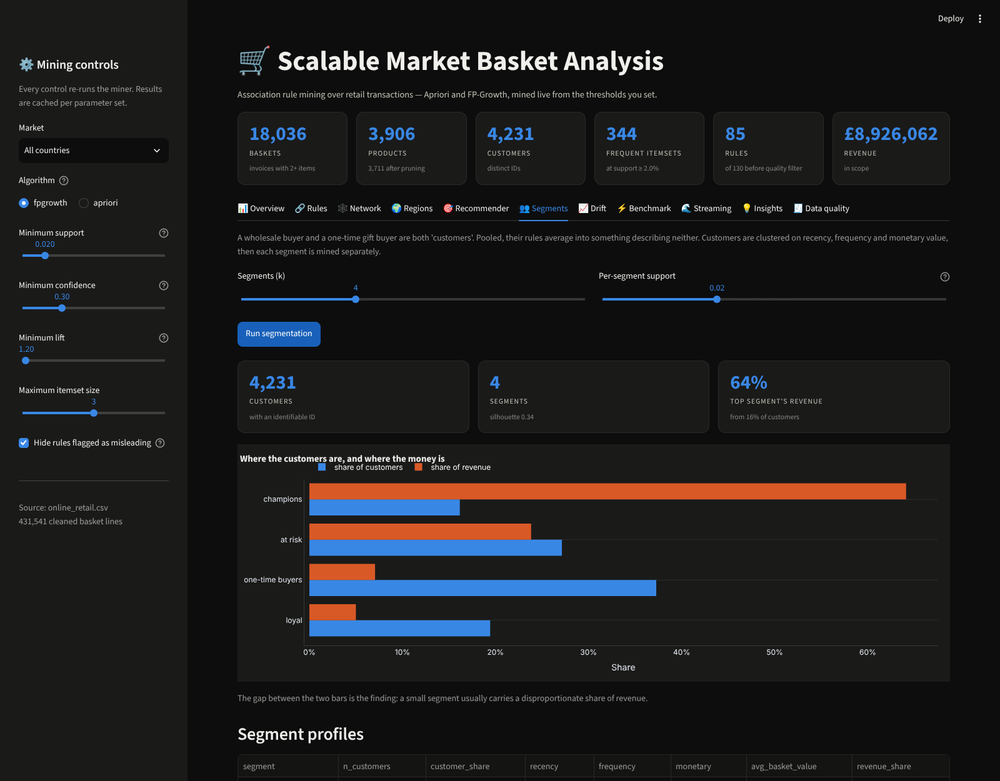
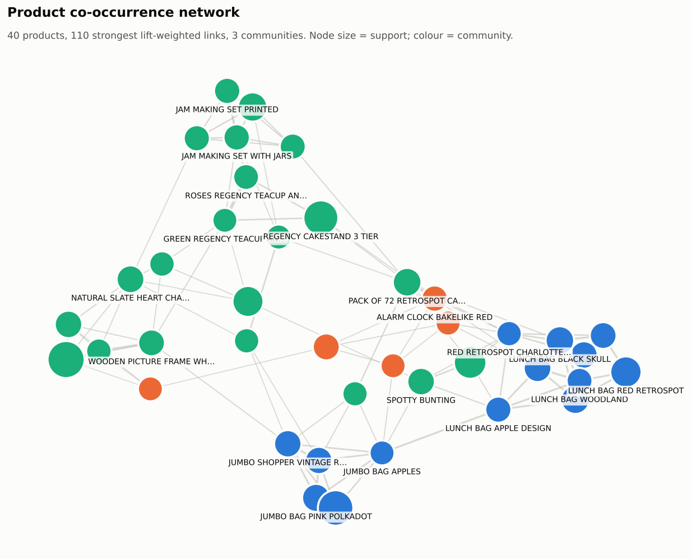
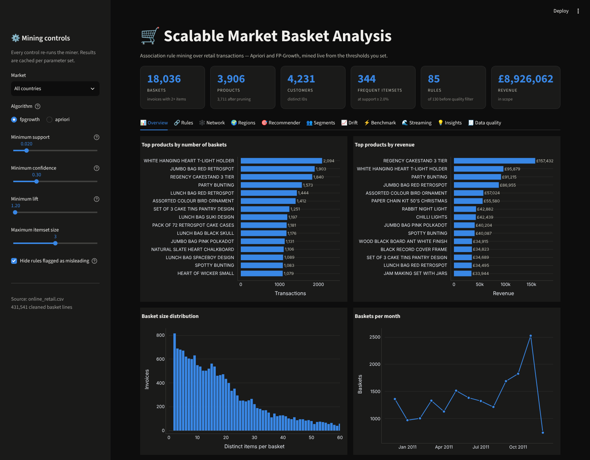
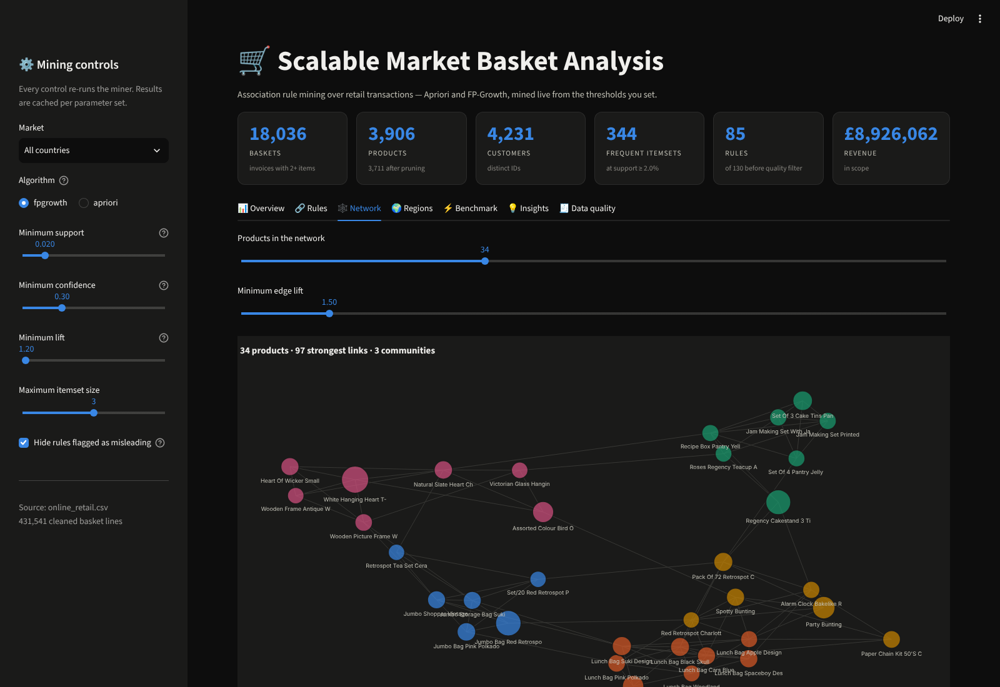

# Scalable Market Basket Analysis

An end-to-end platform for mining association rules out of retail transaction
data and turning them into cross-selling decisions — from raw spreadsheet to
ranked business recommendations, with the scalability work to take the same
analysis from 18 thousand baskets to a million and beyond.

Built for the Honors Semester 7 *Scalable Machine Learning & Big Data
Analytics* course.



---

## What it does

| Stage | What happens |
|---|---|
| **Data engineering** | Cancellation filtering, service-line removal, description normalisation, basket-size bounds — each step audited row-by-row |
| **Encoding** | Sparse CSR basket matrix built by integer factorisation; never materialises the dense form |
| **Mining** | Apriori and FP-Growth, both implemented from scratch, verified against each other, a brute-force checker, and mlxtend |
| **Rules** | Support, confidence, lift, leverage, conviction and Zhang's metric, plus a seven-check triage that separates real bundles from statistical artefacts |
| **Scale** | Benchmark harness, SON out-of-core miner for data beyond RAM, and a PySpark PFP reference for the distributed case |
| **Prediction** | A rule-driven recommender scored on a **held-out future** — temporal split, leave-one-out, against popularity / co-occurrence / random baselines |
| **Analytics** | EDA, NetworkX co-occurrence networks with community detection, per-country mining, RFM customer segmentation, temporal rule drift, automated insight generation |
| **Statistics** | Six interestingness metrics, a seven-check quality triage, and Benjamini-Hochberg FDR correction across the whole rules table |
| **Delivery** | A CLI that runs the whole thing, an 11-tab Streamlit dashboard that re-mines live, and a written report bundle |

---

## Quick start

```bash
git clone https://github.com/Swaroop192005/Scalable-ML-BDA-Project.git
cd Scalable-ML-BDA-Project

pip install -r requirements.txt
pip install -e .

python scripts/download_data.py     # fetches the UCI Online Retail dataset
mba run                             # full pipeline -> reports/ and reports/figures/
mba dashboard                       # interactive app at localhost:8501
```

No download needed to try it — a 2,500-invoice sample is committed:

```bash
mba run -i data/sample/sample_retail.csv
```

---

## The dataset

**UCI Online Retail** (Chen, Sain & Hong, 2012) — 541,909 line items from a
UK-based online gift retailer, 1 Dec 2010 to 9 Dec 2011. Kaggle redistributes
the identical file as *E-Commerce Data* / *Online Retail Dataset*;
`scripts/download_data.py` pulls from UCI by default because that needs no API
token, and supports `--kaggle` if you have the CLI configured.

After cleaning:

| | |
|---|---|
| Raw rows | 541,909 |
| Clean rows | 431,541 (79.6% retained) |
| Baskets | 18,022 |
| Products | 3,355 (after pruning items in fewer than 5 baskets) |
| Customers | 4,231 |
| Countries | 38 |
| Revenue in scope | £8.93M |
| Matrix density | **0.71%** |

---

## Results

### Cleaning is not cosmetic

| Step | Rows removed | Why it matters |
|---|---|---|
| Cancellations (`InvoiceNo` starts with `C`) | 9,288 | Negative quantities create phantom baskets and double-count returns |
| Missing descriptions | 1,454 | No item key, no itemset |
| Service lines (postage, fees, adjustments, damages) | 3,088 | These appear in a large share of invoices, so they co-occur with *everything* and dominate the top rules with nothing actionable behind them |
| Non-positive quantity / price | 580 | £0.00 adjustment lines |
| Duplicate basket lines | 10,791 | Same item twice in one invoice is one basket membership, not two |
| Baskets with fewer than 2 items | 85,167 | A 1-item invoice carries no association |

Every run writes `reports/cleaning_report.csv` with the before/after counts, so
the losses are auditable rather than silent.

### Sparse encoding

A dense one-hot matrix for this data would be 18,022 × 3,355 = 60 million
cells, 99.3% of them zero — 60 MB as `bool`, roughly 480 MB as the `float64`
that a naive `pivot_table` produces.

The CSR matrix holds the same information in **2.2 MB — a 27× reduction** — and
is built straight from integer factorisation, so no dense intermediate ever
exists. Memory scales with *basket lines* (430k), not with baskets × products.

### Apriori vs FP-Growth

Both algorithms return **identical itemsets at every threshold** (asserted in
the test suite and re-checked by the benchmark harness). Only the cost differs:

| min_support | Apriori | FP-Growth | Itemsets | Apriori candidates | FP-Growth candidates |
|---|---|---|---|---|---|
| 0.050 | **0.04 s** | 0.52 s | 29 | 3,761 | 3,355 |
| 0.030 | **0.25 s** | 1.51 s | 131 | 10,859 | 3,363 |
| 0.020 | **1.07 s** | 2.67 s | 344 | 41,391 | 3,394 |
| 0.015 | **3.26 s** | 4.19 s | 628 | 98,554 | 3,457 |
| 0.012 | 5.17 s | **4.92 s** | 985 | 171,137 | 3,539 |
| 0.010 | 7.21 s | **6.86 s** | 1,425 | 262,254 | 3,649 |
| 0.008 | 12.87 s | **7.83 s** | 2,279 | 430,492 | 3,846 |

**The crossover is at support ≈ 0.012.** This is the most interesting result in
the project, and it is not the textbook answer:

- **Above the crossover, Apriori wins — by up to 14×.** At a permissive
  threshold only a few hundred items are frequent, candidate sets are small,
  and tid-set intersection is a couple of vectorised numpy calls. FP-Growth is
  meanwhile paying to build a 127,312-node tree before it mines anything.
- **Below it, FP-Growth pulls away,** and the gap widens monotonically.

The lower panel of the chart above is the explanation. As support falls from 5%
to 0.8%, Apriori's candidate count grows **114×** (3,761 → 430,492) while
FP-Growth's grows **1.15×** (3,355 → 3,846). Apriori's cost is candidate
generation, and that is quadratic in the frequent-item count; FP-Growth
generates no candidates at all.

So "FP-Growth is faster" is only true in the regime that matters at scale. The
honest statement is that **FP-Growth's cost is flat in the thing that explodes**,
which is why it is the right default as catalogues and transaction complexity
grow — exactly the regime this project is about.

### Out-of-core: one million transactions in 206 MB

```
mba ooc --synthetic 1000000 --synthetic-items 5000 -s 0.01 --chunk-size 100000 --memory-budget 800
```

```
SON out-of-core: 1,000,000 transactions in 10 chunks -> 113 itemsets in 254.85s,
peak RSS 206 MB (budget 800 MB), 123 candidates counted
```

**1M transactions mined at 206 MB peak RSS**, against an 800 MB budget that is
enforced rather than assumed — the miner raises `MemoryBudgetExceeded` if RSS
crosses it, so a regression surfaces as a failure instead of a swap storm.

### Rules and their quality

At 2% support, 30% confidence and 1.2 lift: **344 itemsets → 130 rules**, of
which **85 are high value** and **45 are flagged**.

Every one of the 45 is flagged `self_referential` — colour variants of the same
product:

| Rule | Support | Confidence | Lift |
|---|---|---|---|
| `GREEN REGENCY TEACUP AND SAUCER` → `PINK REGENCY TEACUP AND SAUCER` | 3.0% | 63% | **17.4** |
| `PINK REGENCY TEACUP…` → `GREEN + ROSES REGENCY TEACUP…` | 2.6% | 71% | **19.7** |

These are the highest-lift rules in the entire dataset and they are
commercially empty: "customers who buy the green teacup also buy the pink one"
describes the product catalogue, not customer behaviour. Thresholding on
support/confidence/lift alone puts them at the top of the table.

The rules that survive triage are the actionable ones:

| Rule | Support | Confidence | Lift | Leverage |
|---|---|---|---|---|
| `GARDENERS KNEELING PAD CUP OF TEA` → `GARDENERS KNEELING PAD KEEP CALM` | 2.6% | 71% | 15.8 | 0.024 |
| `SPACEBOY LUNCH BOX` → `DOLLY GIRL LUNCH BOX` | 2.7% | 58% | 14.4 | 0.025 |
| `WOODEN FRAME ANTIQUE WHITE` → `WOODEN PICTURE FRAME WHITE FINISH` | 2.8% | 57% | 10.0 | 0.025 |
| `JUMBO BAG PINK POLKADOT` → `JUMBO BAG RED RETROSPOT` + `JUMBO STORAGE BAG SUKI` | 2.0% | 32% | 9.2 | 0.018 |

### Do the rules predict anything?



Mining proves a pattern existed. It does not prove the pattern predicts. The
recommender is trained on 13,527 baskets up to 2011-10-11 and scored on
4,471 leave-one-out cases from the two months that follow — a **temporal**
split, because in production you only ever have the past. Rules are mined on
the training split only.

| model | hit@1 | hit@5 | hit@10 | MAP@5 | coverage | novelty | vs popularity |
|---|---|---|---|---|---|---|---|
| **association** | **6.13%** | **13.40%** | **17.69%** | **0.086** | 13.3% | 4.54 | **9.1×** |
| cooccurrence | 2.82% | 8.52% | 12.66% | 0.049 | 54.2% | 9.65 | 5.8× |
| popularity | 0.40% | 1.48% | 2.80% | 0.008 | 0.4% | 3.24 | 1.0× |
| random | 0.02% | 0.13% | 0.38% | 0.001 | 99.7% | 8.87 | 0.09× |

Two things matter more than the headline number.

**Association beats raw co-occurrence by 1.6×.** That is the comparison that
justifies the mining pipeline existing. If support thresholds, confidence and
lift could not beat simply counting pairs, they would be cost without
benefit.

**It is also the narrowest model in the table** — 13.3% catalogue coverage
against co-occurrence's 54.2%. It is accurate partly by concentrating on a
well-trodden slice of the range. That is a real trade-off, not an
unqualified win, and the evaluation reports it rather than burying it.

### Customers do not shop alike



RFM segmentation (k-means++, implemented from scratch) over 4,231 customers:

| segment | customers | share | median spend | revenue share |
|---|---|---|---|---|
| champions | 684 | 16% | £3,652 | **64%** |
| at risk | 1,148 | 27% | £1,332 | 24% |
| loyal | 822 | 19% | £423 | 5% |
| one-time buyers | 1,577 | 37% | £302 | 7% |

**16% of customers produce 64% of revenue** — and they shop differently. The
*loyal* segment's strongest rules are Christmas decorations; champions and
one-time buyers are dominated by the Regency teacup range. A single global
rules table averages that away.

### Affinities are stable; volume is not

Mining each month independently classifies 848 distinct rules:

| stable | emerging | decaying | **seasonal** | intermittent | sporadic |
|---|---|---|---|---|---|
| 11 | 13 | 20 | **0** | 120 | 680 |

**No rule is statistically seasonal.** The highest lift coefficient of
variation is 0.32 against a 0.60 threshold — while basket volume swings from
968 in January to 2,524 in November. Christmas changes *how much* people buy
here, not *what goes with what*. The threshold was left alone rather than
lowered to manufacture seasonal labels.

### Statistics that survive the volume of hypotheses

A chi-squared independence test runs per rule. Testing hundreds at p < 0.05
means ~5% clear the bar by chance, so the raw flag does not mean what it
appears to. The `not_significant` check now reads a **Benjamini-Hochberg**
FDR-adjusted q-value, controlling the expected share of false positives
among the rules declared significant. Bonferroni was rejected as far too
conservative — the tests are positively dependent, since rules share items.

### Compact representations, and where they do not help

`maximal ⊆ closed ⊆ frequent`, always. Closed itemsets are lossless for
support: every frequent itemset's exact count is recoverable from them.

| dataset | frequent | closed | maximal |
|---|---|---|---|
| Online Retail @ 1.5% | 628 | **628** (1.0×) | 491 (1.3×) |
| dense synthetic | 38 | **4** (9.5×) | 3 (12.7×) |

Closure gives **zero compression** on the real data. Not a bug — the same
code compresses 9.5× on dense input, and `mba compact --verify` confirms all
628 supports are recoverable. Closure only collapses an itemset into a
superset of *identical* support, which with thousands of products and
24-item baskets essentially never happens. Compact representations are a
dense-data technique, and quoting a ratio without naming the regime would
mislead.

### Streaming, with the guarantees checked

Lossy Counting over the real data at 2% support, ε = 0.002:

| guarantee | expected | observed |
|---|---|---|
| No false negatives | 0 | **0** |
| Counts never overestimate | False | **False** |
| Undercount ≤ ε·N | ≤ 36 | **18** |
| Table within space bound | ≤ 42,882 | **2,676** |

The classical `(1/ε)·log(ε·N)` space bound assumes *one item per
observation*. A basket inserts ~24 at once, so the real table legitimately
exceeds it (2,656 vs 1,792) and the applicable bound is the scaled one.
Reporting the unscaled figure would have claimed a guarantee the algorithm
does not give here, so both are exposed separately.

### Networks and regions



The lift-weighted co-occurrence graph over the top 40 products resolves into
**3 communities** — lunch bags, jumbo bags, and kitchen/homeware — discovered
from behaviour rather than from the merchandising hierarchy. Betweenness
centrality identifies the *bridges* between them (`SPOTTY BUNTING`,
`WHITE HANGING HEART T-LIGHT HOLDER`), which are the cheapest route into a
second category.

Regional mining matters because the UK is **91% of all baskets**. A single
global rules table is effectively a UK table:

| Market | Baskets | Rules at local threshold |
|---|---|---|
| United Kingdom | 16,266 | 23 |
| Germany | 424 | 159 |
| France | 363 | 755 |
| EIRE | 265 | 1,182 |

Smaller markets yield *more* rules, not fewer, once support is calibrated
locally — their baskets are more homogeneous. The EIRE teacup associations
reach 5.3× lift and do not clear the global threshold at all.

---

## The dashboard



```bash
mba dashboard
```

Eleven tabs — Overview, Rules, Network, Regions, Recommender, Segments,
Drift, Benchmark, Streaming, Insights, Data quality. Every control
**re-runs the miner**; nothing is filtered from a
precomputed table. Streamlit caches on the parameter set, so a threshold you
have already visited returns instantly while a new one actually re-mines.



---

## Project layout

```
config/config.yaml          every threshold, path and column name
src/mba/
  config.py                 YAML loading, dotted access, --set overrides
  data/
    loader.py               multi-format reading, CSV caching, chunked streaming
    preprocess.py           cleaning sequence + audit trail
    basket.py               sparse CSR basket encoding
  mining/
    base.py                 shared result types and the miner registry
    apriori.py              level-wise generate / prune / count
    fpgrowth.py             FP-tree, conditional pattern bases, recursion
    compact.py              maximal and closed itemsets
    rules.py                rule generation and the six metrics
    spurious.py             seven-check triage + Benjamini-Hochberg FDR
  scaling/
    benchmark.py            the support sweep and scaling curve
    outofcore.py            SON two-pass streaming miner
    streaming.py            Lossy Counting, single pass, bounded memory
    spark_fpgrowth.py       distributed PFP reference architecture
  analytics/
    eda.py                  descriptive tables
    network.py              co-occurrence graphs, communities, centrality
    regional.py             per-country mining and divergence
    segmentation.py         RFM + k-means (from scratch), per-segment rules
    temporal.py             per-period mining and rule drift classification
    insights.py             the rulebook that turns rules into recommendations
  recommend/
    engine.py               rule-driven recommender + three baselines
    evaluate.py             temporal split, leave-one-out, the metrics
  viz/
    theme.py                one validated palette, light and dark
    plots.py                the report figures
  pipeline.py               stage orchestration
  cli.py                    the `mba` command
dashboard/app.py            Streamlit app
tests/                      269 tests
scripts/download_data.py    dataset fetcher (UCI or Kaggle)
```

---

## CLI

```bash
mba run                      # full pipeline -> reports/
mba run --benchmark --scaling
mba eda                      # descriptive analysis only
mba mine -a apriori -s 0.015 --min-confidence 0.4
mba bench -g 0.05 0.03 0.02 0.01 --scaling
mba ooc --synthetic 1000000 --chunk-size 100000 --memory-budget 800
mba spark                    # distributed run, or the architecture notes
mba regional --countries France Germany EIRE
mba recommend                # held-out evaluation vs three baselines
mba recommend --demo         # one explained recommendation
mba segment --choose-k       # sweep k, report inertia and silhouette
mba segment -k 4             # RFM segments + per-segment rules
mba temporal -f M            # monthly rule drift
mba stream --verify          # single-pass mining, guarantees checked
mba compact --verify         # maximal/closed, support recovery proved
mba dashboard
mba sample -n 2500           # write a small committed sample
```

Any configuration key can be overridden without editing the file:

```bash
mba run --set mining.min_support=0.01 --set mining.algorithm=apriori
```

---

## Configuration

Nothing in `src/` hard-codes a threshold, a path or a column name — it all
lives in `config/config.yaml`, organised by stage (`preprocess`, `basket`,
`mining`, `spurious`, `scaling`, `analytics`, `viz`, `dashboard`). Point the
`schema` section at different column names and the whole pipeline runs on a
different retailer's export.

---

## Testing

```bash
pytest                 # 269 tests, ~30 seconds
pytest -m "not slow"   # skip the real-dataset tests
pytest -m slow         # only the real-dataset tests
```

The correctness strategy is layered, because "the algorithm ran" is not
evidence that it is right:

1. **Brute force.** An exhaustive reference implementation lives in
   `tests/conftest.py`. Both miners must match it exactly.
2. **Randomised agreement.** 50 random datasets per run, with random support
   thresholds and length caps; Apriori, FP-Growth and brute force must all
   agree on every one.
3. **Structural invariants.** Downward closure is asserted directly: every
   subset of a frequent itemset must itself be frequent and at least as
   frequent.
4. **Third-party parity.** `tests/test_reference_parity.py` checks our itemsets
   *and* our rule metrics against **mlxtend**, so the definitions match an
   independent implementation and not just our own reading of the papers.
5. **SON exactness.** The out-of-core miner must return bit-identical results
   to the in-memory one at every chunk size — the guarantee is worthless if it
   is not tested.
6. **Real data.** Seven `slow` tests run against the full UCI file, including a
   domain check that the known Regency teacup associations are recovered.
7. **Guarantees, not claims.** Lossy Counting's three guarantees are each
   asserted against an exact count; closure's losslessness is proved by
   recovering every frequent itemset's support from the closed set alone;
   Benjamini-Hochberg is checked against the 1995 paper's worked example.
8. **Leakage.** The recommender tests assert that top-k is a prefix of top-K
   (the property the one-pass evaluation relies on), that items unseen in
   training are excluded, and that single-item test baskets are skipped.

---

## Scaling ladder

| Path | Practical ceiling | Bound by |
|---|---|---|
| In-memory (`mba run`) | ~10⁵–10⁶ baskets | RAM for the sparse matrix |
| SON out-of-core (`mba ooc`) | ~10⁷ baskets | single-node CPU; data streams, compute does not |
| Spark PFP (`mba spark`) | 10⁸+ baskets | cluster size |

`src/mba/scaling/spark_fpgrowth.py` documents and implements the distributed
case — parallel counting, item grouping, parallel projection (the single
shuffle), local FP-Growth per shard, aggregation — along with the sizing
guidance that actually matters: shuffle partitions at 2–3× executor cores,
source partitioned by date and region, and raising `minSupport` before raising
cluster size, since support is the exponent and hardware is only a constant
factor.

PySpark is an optional extra. Without it the module still imports, and
`mba spark` prints the architecture reference instead of failing.

---

## Notes on method

**Why Apriori counts the way it does.** The implementation is textbook
level-wise Apriori — F(k−1) × F(k−1) join, downward-closure pruning — but
support counting uses vertical tid-sets rather than re-scanning the database
per level. That is mathematically identical and replaces a Python loop over
every basket with one vectorised `numpy.intersect1d`, which is what makes a
pure-Python Apriori tractable here. It also means the benchmark is *fair*: the
comparison is between the two algorithms' structures, not between a tuned
implementation and a naive one.

**Why six metrics rather than lift.** Lift is unbounded and unstable for rare
consequents — a pair seen four times can top the chart. Leverage keeps the
absolute size of the effect in view, conviction is sensitive to the direction
of implication, and Zhang's metric stays interpretable when the marginals are
skewed. Ranking on several of them is what separates a real bundle from an
artefact.

**Why revenue estimates are labelled indicative.** The insight generator sizes
each recommendation from baskets that contain the antecedent but not the
consequent, under a stated 15% attach-rate assumption. That is a sizing aid for
ranking recommendations against each other, not a forecast, and it is labelled
as such everywhere it appears.

---

## Further reading

- [`docs/ALGORITHMS.md`](docs/ALGORITHMS.md) — how Apriori, FP-Growth, SON and PFP work, and why the crossover sits where it does
- [`docs/METRICS.md`](docs/METRICS.md) — the six metrics and the seven-check quality triage
- [`docs/PREDICTIVE.md`](docs/PREDICTIVE.md) — held-out evaluation, FDR correction, compact representations, streaming, segmentation and drift

## References

- Agrawal & Srikant (1994), *Fast Algorithms for Mining Association Rules*, VLDB — Apriori
- Han, Pei & Yin (2000), *Mining Frequent Patterns without Candidate Generation*, SIGMOD — FP-Growth
- Savasere, Omiecinski & Navathe (1995), *An Efficient Algorithm for Mining Association Rules in Large Databases*, VLDB — SON
- Li et al. (2008), *PFP: Parallel FP-Growth for Query Recommendation*, RecSys — the Spark algorithm
- Zhang (2000), *Association Rules* — Zhang's metric
- Manku & Motwani (2002), *Approximate Frequency Counts over Data Streams*, VLDB — Lossy Counting
- Benjamini & Hochberg (1995), *Controlling the False Discovery Rate*, JRSS-B — the FDR correction
- Pasquier et al. (1999), *Discovering Frequent Closed Itemsets for Association Rules*, ICDT — closed itemsets
- Arthur & Vassilvitskii (2007), *k-means++: The Advantages of Careful Seeding*, SODA — the clustering seeding
- Chen, Sain & Hong (2012), *Data mining for the online retail industry*, Journal of Database Marketing — the dataset

## Licence

MIT.
